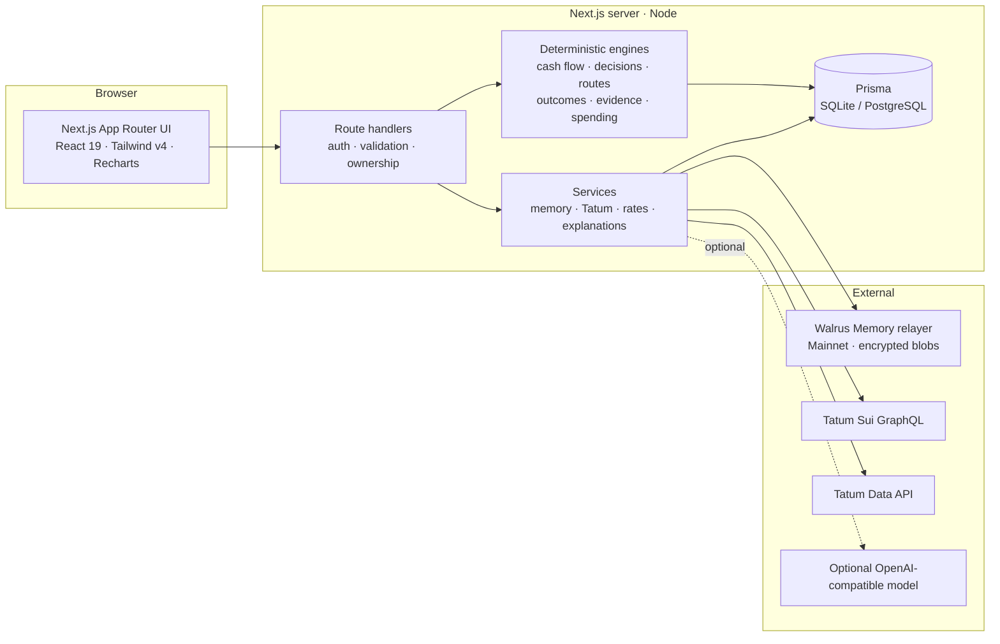
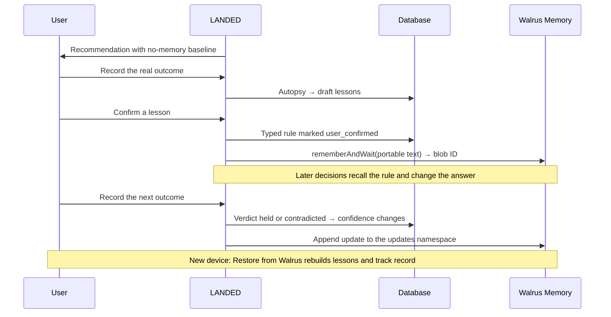

<div align="center">


# LANDED

### Know what is safe to move — before you move it.

LANDED is a personal finance application that turns balances, bills, income, and real outcomes into one clear answer: **how much can you safely send, save, or spend right now?**

It keeps a durable, portable memory of what actually happened, so each later recommendation is grounded in evidence rather than a fresh guess.

[**Live application →**](https://landed-production-3dc8.up.railway.app) &nbsp;·&nbsp; [Product tour](docs/demo-script.md) &nbsp;·&nbsp; [Architecture](docs/architecture.md) &nbsp;·&nbsp; [Engineering notes](docs/blog.md)

`Next.js 16` · `React 19` · `TypeScript` · `Prisma` · `Walrus Memory` · `Tatum`

</div>

---

## Overview

A balance alone is not a plan. Rent is due in nine days, a phone bill is scheduled, groceries are still coming, and part of the account should never be touched. Most finance tools report the total and leave the judgment to you. Most also forget what happened next: the transfer that cost more than quoted, the salary that arrived late, the subscription that quietly increased.

LANDED answers the question people actually ask — *what is safe to move right now?* — then records the real outcome and turns confirmed lessons into rules that shape future advice.

```text
financial context  →  deterministic decision  →  action  →  observed outcome
       ↑                                                        │
       └──────  confirmed memory  ←  user approval  ←───────────┘
```

The result is a finance product that behaves less like a dashboard and more like a careful advisor with a documented memory.

## Live application

| | |
| --- | --- |
| **Application** | https://landed-production-3dc8.up.railway.app |
| **New account** | Two-minute setup: current balance, recurring bills, last paycheck. No bank login or wallet required. |
| **Demo account** | Choose **Explore the live demo** on the landing page, or use `demo@landed.app` / `landed-demo-2026`. The demo is clearly labelled synthetic data with several weeks of learning already recorded. |

A short product tour:

1. **Overview** — safe-to-move, projected low point, protected bills, and the learning curve.
2. **Plan a move** — ask to send $300; compare the memory-informed answer with the no-memory baseline.
3. **Spend Watch** — see alerts that exist only because the user previously approved a rule.
4. **Memory** — inspect lesson status, evidence, confidence, blob IDs, and Total Recall.
5. **Ask LANDED** — *“Can I spend $60 on dining tonight?”* and *“What did you tell me last time I asked about sending money?”*

The full walkthrough is in [docs/demo-script.md](docs/demo-script.md).

## Capabilities

### Safe-to-move decisions
- A **45-day cash-flow simulation** covering essential and important bills, recurring obligations, savings contributions, historical variable spending, and a protected buffer.
- Balances and transaction amounts use **integer minor units**. Exchange-rate calculations use numeric rates and round to the destination currency’s minor unit; model-generated explanations do not calculate the amounts.
- **Expected income is not treated as cash** until it arrives, unless the user opts in per decision; even then it is reliability-weighted.
- Every recommendation preserves its input snapshot, the memory-informed action, the no-memory baseline, its prediction, and the memories that changed it.
- **Route ranking by the amount expected to arrive**, accounting for recipient amount, total cost, speed, and evidence quality.
- **Learning Replay** re-runs a decision on the identical snapshot with and without memory. Lessons learned after the decision cannot leak backwards.

### Memory that improves advice
- **Advice Autopsy** separates observed facts from hypotheses, calculates prediction error, and drafts candidate lessons.
- **Typed rules** change cash-flow math, transfer caps, splits, reserves, and route ranking. Every adjustment names the memory responsible for it.
- **Nothing becomes memory automatically.** The user reviews and confirms each lesson before it is persisted.
- **Track record** grades every lesson behind an outcome as *held* or *contradicted*. Confidence moves with evidence and weights how strongly the rule acts next time. A repeatedly failing lesson is flagged for review, never silently deleted.
- **Learning curve** shows rules in force and advice that held over time.

### Spend Watch
- Detects recurring charges with fixed prices and regular schedules, plus category spending that is running ahead of the user's usual month.
- Alerts only against rules the user chose: a learned monthly `SPEND_LIMIT` or an approved subscription price (`SUBSCRIPTION_WATCH`).
- Without memory there are no alerts by construction. With memory, every alert identifies the lesson behind it.
- Rules are recalled from Walrus on every check, with visible provenance: *recalled from Walrus* or *local ledger*.

### Total Recall
- Memory belongs to the person, not the device. The Walrus namespace is derived server-side from the account ID.
- **Restore from Walrus** rebuilds available lessons, current confidence, superseded rules, and the track record for the same account.
- Relayer inventory independently confirms what is stored, separate from LANDED's own database.

### Decision journal
- An opt-in record of each question, recommendation, and reasoning, stored in a dedicated Walrus namespace.
- Supports questions such as *“What did you tell me last time?”*
- Journal entries are recall-only and can never act as financial rules.

### Connected data
- **Guided onboarding** for balances, recurring bills, and the last paycheck; income is forecast from its cadence.
- **Transaction entry** and **CSV import** with signed amounts, duplicate detection, and import batches.
- **Sui wallet sync** and **transaction verification** through Tatum, including sourced exchange rates.
- **Optional AI explanations** in plain language. Any explanation containing a number LANDED did not compute is discarded.

### Account and data controls
- Change password and revoke other sessions.
- Export all data as JSON.
- Exclude individual lessons from future advice.
- Manage opt-in consents.
- Delete the account.
- Read a plain-language privacy policy in the application.

## How memory changes the answer

Illustrative example using the same balance and the same question: **“Can I send $300 to my sister today?”** Results depend on the actual records and confirmed lessons.

| | Without memory | With LANDED's memory |
| --- | --- | --- |
| **Answer** | Send **$300** | Recommend **$150 now**; reassess the remainder after income arrives |
| **Why** | The balance covers it | A confirmed lesson caps a single move at 50% of safe-to-move while rent is near; a remembered route outcome favors the more reliable route |
| **Evidence** | — | Each adjustment names its memory ID and, once written, its Walrus blob ID |

The same mechanism applies to everyday spending:

| | Without memory | With memory |
| --- | --- | --- |
| **Spend Watch alerts** | **0** | **2** — *Streaming bundle charged $21.99; approved price is $18.00* and *Dining is $32 over the $120 limit* |
| **“Can I spend $60 on dining?”** | Cash allows it | *“Cash-wise, yes. By the limit you asked me to hold, it would put dining $92 over — so no.”* |

## Architecture



| Layer | Technology |
| --- | --- |
| Application | Next.js 16.4 App Router, React 19, TypeScript 5 |
| Interface | Tailwind CSS v4, Recharts, Lucide; variable fonts via `next/font` |
| Data | Prisma 6, SQLite by default with a PostgreSQL-portable schema |
| Memory | `@mysten-incubation/memwal` on Walrus Mainnet |
| Onchain data | Tatum Sui GraphQL, Tatum Data API v4 |
| Validation | Zod 4 |
| Testing | Vitest 5, including the Walrus SDK mock |
| Deployment | Multi-stage Docker image on Railway |

### Design principles

1. **No fabricated confirmations.** A memory is `confirmed` only when the relayer returns a blob ID. Otherwise it is `blocked`, `failed`, or `pending`, and the interface says so.
2. **The user approves memory.** Outcomes propose lessons; people confirm them.
3. **Deterministic financial logic.** Every amount, cap, reserve, and comparison is computed in tested code.
4. **Every adjustment is attributable.** Advice names the memory that changed it.
5. **Memory can be wrong.** Track records reduce the influence of lessons that fail.
6. **Blockchain stays in the background.** Dollars come first; chain details appear only as proof.

## Memory model

LANDED separates the authoritative rule from its portable copy:

- **Database:** authoritative typed rule, ownership boundary, and audit trail.
- **Walrus:** self-describing text containing the typed rule, scope, and supporting context, available across devices and installations.

On recall, the database rule wins. The Walrus text is a fallback, so a malformed blob cannot silently rewrite financial logic. Walrus blobs are immutable; changes are appended rather than overwritten.

### Namespaces

| Namespace | Contents | Used as a rule? |
| --- | --- | --- |
| `landed-<24 hex>` | Confirmed lessons with embedded typed rules | **Yes** — recalled for decisions and Spend Watch |
| `landed-<24 hex>-updates` | Append-only confidence changes, supersession, and exclusions | Replayed newest-wins on restore |
| `landed-<24 hex>-journal` | Opt-in question, advice, and reasoning record | **Never** — recall only |

`<24 hex>` is the first 24 hexadecimal characters of `sha256("landed:account:" + userId)`, derived server-side. The same account can restore its memory across devices. A newly created account, even with the same email, cannot access the previous account’s namespace. Existing email-derived blobs remain in their original namespace; confirmed local lessons can be saved to the current namespace from Memory.

### Lesson lifecycle



### Typed rules

| Rule | Effect |
| --- | --- |
| `AMOUNT_CAP` | Cap a single move at a share of safe-to-move |
| `SPLIT_TRANSFER` | Split a risky transfer and schedule the remainder |
| `DELAY_REMAINDER` | Wait for income before sending the remainder |
| `RESERVE_COMMITMENT` | Reserve extra for a matching bill within N days |
| `EXCLUDE_EXPECTED_INCOME` | Ignore income below a reliability threshold |
| `BUFFER_FLOOR` | Raise the protected buffer |
| `ROUTE_PENALTY` / `ROUTE_PREFERENCE` | Adjust route scores from observed outcomes |
| `PAYOUT_DEDUCTION` | Reduce the expected recipient amount for a route |
| `SPEND_LIMIT` | Monthly category limit for Spend Watch and purchase checks |
| `SUBSCRIPTION_WATCH` | Approved price for a recurring merchant |

Only confirmed lessons and verified journal entries are written to Walrus. Drafts and rejected lessons remain in the database.

## Integrations

### Walrus Memory

LANDED uses the Walrus Memory SDK for `rememberAndWait`, `recall`, `restore`, `listMemories`, and `health`. A record is confirmed only after the relayer returns a blob ID. Restore asks the relayer to re-index missing blobs before recall, and verification compares the local ledger with relayer inventory.

Walrus Memory is optional at runtime. Without credentials, memory features report `blocked` or `not configured`; the application never simulates a write.

### Tatum

Sui reads use Tatum's GraphQL gateway at `https://sui-mainnet.gateway.tatum.io/graphql`.

| Query | Used for |
| --- | --- |
| `checkpoint { sequenceNumber }` | Reachability and health |
| `address { balances { coinType totalBalance coinMetadata } }` | Wallet balances with correct decimals |
| `address { transactions(relation: AFFECTED) }` | Wallet history import, incoming and outgoing |
| `transaction(digest) { effects { status gasEffects balanceChanges } }` | Settlement evidence: status, sender, balance changes, net gas |

A transaction digest entered with an outcome is **re-read through Tatum server-side** before anything is marked `onchain_verified`. The browser's claim is never trusted. Lessons drafted from verified outcomes carry `verified_onchain` evidence.

Tatum's Data API supplies exchange rates through `POST /v4/data/rate/symbol/batch`, cached for 60 seconds. Rates remain exact decimal strings and are applied with BigInt arithmetic. Converted values are shown with source and timestamp, and are never added to safe-to-move.

Tatum's free plan allows three requests per second; rate-limited calls back off and retry. Without `TATUM_API_KEY`, onchain routes return HTTP 503 with an explicit `not configured` state. LANDED never substitutes a public RPC.

### AI explanations

The AI layer is optional and OpenAI-compatible. It receives a compact, server-built explanation request and cannot compute amounts, rank routes, confirm outcomes, or write memory. With no configuration, deterministic explanations are used.

## Security and privacy

- **Authentication:** scrypt-hashed passwords, random session tokens stored only as SHA-256 hashes, `httpOnly` + `SameSite=Lax` + `Secure` cookies, 30-day sessions. Changing a password revokes other sessions.
- **Authorization:** every query is scoped by the authenticated user ID. Cross-user access is tested against a real database. Walrus is never the authorization boundary.
- **Request hardening:** Zod validation on inputs, origin checks on writes, per-user and per-IP rate limits, and security headers including HSTS, `X-Frame-Options`, `X-Content-Type-Options`, `Referrer-Policy`, and `Permissions-Policy`.
- **Secrets:** Tatum, Walrus, and AI credentials are server-only and never prefixed `NEXT_PUBLIC_`.
- **Data rights:** JSON export, per-lesson exclusion, account deletion, and opt-in consents. The application explains that Walrus blobs are encrypted and permanent before account deletion.

## Getting started

**Prerequisites:** Node.js 22+ and pnpm 9.

```bash
pnpm install
cp .env.example .env
pnpm setup      # generate Prisma client, apply schema, seed the demo
pnpm dev
```

Open http://localhost:3000. Create an account, or choose **Explore the live demo**.

| Command | Purpose |
| --- | --- |
| `pnpm dev` | Development server |
| `pnpm build` / `pnpm start` | Production build and serve |
| `pnpm typecheck` / `pnpm lint` / `pnpm test` | Quality gates |
| `pnpm setup` | Generate client, apply schema, seed demo |
| `pnpm db:seed` | Recreate the demo account |
| `pnpm db:reset` | Reset the local database and reseed |
| `pnpm demo:snapshot` | Print the demo's headline numbers and learning curve |
| `pnpm walrus:backfill` | Write confirmed lessons, journal entries, and updates to Walrus |
| `pnpm walrus:verify` | Verify the local ledger against relayer inventory |

## Configuration

| Variable | Required | Description |
| --- | --- | --- |
| `DATABASE_URL` | Yes | `file:./dev.db` locally; `file:/app/data/landed.db` in the container |
| `NEXT_PUBLIC_APP_URL` | Yes | Public base URL |
| `TATUM_API_KEY` | For onchain features | Server-only Tatum key; enables Sui reads and the Data API |
| `TATUM_SUI_RPC_URL` | No | Defaults to `https://sui-mainnet.gateway.tatum.io` |
| `TATUM_SUI_NETWORK` | No | `mainnet` |
| `TATUM_DATA_API_URL` | No | Defaults to `https://api.tatum.io` |
| `MEMWAL_PRIVATE_KEY` | For Walrus | Walrus Memory delegate key; never the owner key |
| `MEMWAL_ACCOUNT_ID` | For Walrus | Walrus Memory account ID |
| `MEMWAL_SERVER_URL` | No | Defaults to `https://relayer.memory.walrus.xyz` |
| `MEMWAL_APP_PREFIX` | No | Namespace prefix, default `landed` |
| `AI_BASE_URL` / `AI_API_KEY` / `AI_MODEL` | No | Optional OpenAI-compatible explanations |
| `LANDED_DEMO_ENABLED` | No | `false` disables the demo login |
| `LANDED_SEED_DEMO` | No | `true` seeds the demo once on container boot |

## Deployment

The repository includes a production `Dockerfile` and `railway.json`.

### Railway

1. Create a service from the repository using the Dockerfile builder.
2. Attach a volume at **`/app/data`**. SQLite lives at `/app/data/landed.db`.
3. Set `RAILWAY_RUN_UID=0` so the container can write to the Railway volume, plus `PORT=3000` and `NEXT_PUBLIC_APP_URL`.
4. Set `LANDED_SEED_DEMO=true` to create the labelled demo account on first boot.
5. Add Tatum and Walrus credentials when enabling Mainnet integrations.

On boot the container applies the Prisma schema and, if enabled, seeds the demo **once**. Later boots roll the demo's dates forward instead of reseeding, preserving lesson IDs and Walrus blob IDs. The healthcheck is `GET /api/health`, which verifies database access.

### Docker

```bash
docker build -t landed .
docker run -p 3000:3000 \
  -v landed-data:/app/data \
  -e LANDED_SEED_DEMO=true \
  landed
```

For managed PostgreSQL, change the Prisma datasource provider and run migrations in a release step. Full instructions are in [docs/setup.md](docs/setup.md).

### Enabling Mainnet integrations

1. Create a Walrus Memory agent and a **delegate key**; set `MEMWAL_PRIVATE_KEY` and `MEMWAL_ACCOUNT_ID`.
2. Create a Tatum API key; set `TATUM_API_KEY`.
3. Write and verify memories:

```bash
pnpm walrus:backfill --include-synthetic   # demo account only
pnpm walrus:verify
```

4. Confirm status in **Memory → Walrus verification** and **Settings → Integrations**.

On a deployed Railway service, run backfill inside the container:

```bash
railway ssh -- ./node_modules/.bin/tsx scripts/walrus-backfill.ts --include-synthetic
```

## Quality

```bash
pnpm typecheck && pnpm lint && pnpm test && pnpm build
```

The suite contains **85 tests across 16 files**, covering:

- Money parsing, zero-decimal currencies, rounding, and formatting.
- Cash flow, income exclusion, caps, reserves, recurring bills, and shortfalls.
- Route ranking, payout deductions, expired quotes, autopsy, and lesson extraction.
- Replay cutoff clamping, so later lessons cannot leak into earlier decisions.
- Spend Watch recurrence detection, memory-only alerts, and purchase checks.
- Track-record verdicts, bounded confidence, and review thresholds.
- Walrus flows against the SDK mock: confirmed writes, inventory, recall coverage, update flushing, journal recall, and same-account restore.
- Portable memory text round trips and corrupted-rule handling.
- BigInt rate conversion, CSV import, and AI explanation guards.
- Cross-user authorization and demo-clock behavior.

## Project structure

```text
src/
  app/                  Pages and API route handlers
  components/           Dashboard, plan, Spend Watch, memory, decisions, settings
  lib/                  Shared types, money primitives, client helpers
  server/
    engine/             Cash flow, decisions, routes, outcomes, evidence, spending
    services/           Walrus memory, Tatum, rates, decisions, spending, explanations
    api.ts · auth.ts    Route wrapper and session management
prisma/                 Schema and labelled demo seed
scripts/                Walrus backfill/verify, demo snapshot, container startup
tests/                  Vitest suites
docs/                   Architecture, setup, product tour, engineering notes
```

## API reference

All routes except authentication, health, and the demo login require a session. All data is scoped to the signed-in user.

| Area | Endpoints |
| --- | --- |
| Auth | `POST /api/auth/signup` · `POST /api/auth/login` · `POST /api/auth/logout` · `GET /api/auth/me` · `POST /api/auth/demo` |
| Account | `POST /api/account/password` · `DELETE /api/account` · `GET/PATCH /api/settings` · `GET/POST /api/consents` · `GET /api/export` |
| Setup | `POST /api/onboarding` |
| Money data | `GET/POST /api/accounts` · `PATCH/DELETE /api/accounts/:id` · `GET/POST /api/transactions` · `POST /api/transactions/import` · `/api/commitments[/:id]` · `/api/savings-goals[/:id]` · `/api/routes` · `/api/routes/:id/quotes` |
| Decisions | `GET/POST /api/decisions` · `GET /api/decisions/:id` · `/api/decisions/:id/follow` · `POST /api/decisions/:id/outcome` · `GET/POST /api/decisions/:id/replay` · `POST /api/ask` · `GET /api/dashboard` |
| Spend Watch | `GET /api/spending` · `POST /api/spending/remember` |
| Memory | `GET /api/memories` · `POST/PATCH /api/memories/:id/feedback` · `POST /api/memories/:id/write` · `POST /api/memories/restore` · `GET /api/memories/verify` · `GET /api/learning` · `GET/POST /api/community` |
| Tatum | `GET/POST/PATCH /api/tatum/wallet` · `POST /api/tatum/transaction` · `GET /api/tatum/rates` |
| Operations | `GET /api/health` (public) · `GET /api/integrations/health` |

Errors are JSON objects with the shape `{ error, code, details? }` and conventional status codes: `400` validation, `401` unauthenticated, `403` forbidden, `404` not found, `409` conflict, `429` rate limited, and `503` for an unconfigured integration.

## Data model

| Model | Purpose |
| --- | --- |
| `User`, `Session`, `Consent`, `AuditEvent` | Identity, hashed session tokens, opt-ins, audit trail |
| `FinancialAccount`, `Transaction`, `ImportBatch` | Balances, activity, CSV import deduplication |
| `Commitment`, `SavingsGoal` | Recurring bills and savings targets |
| `PaymentRoute`, `RouteQuote`, `RouteObservation`, `CommunityRouteStatistic` | Routes, quotes, observed outcomes, opt-in aggregates |
| `FinancialDecision`, `MoneyMovement`, `DecisionOutcome` | Snapshotted advice, actions taken, observed results |
| `MemoryRecord` | Lessons and journal entries with typed rules, write status, and blob IDs |
| `MemoryEvidence` | Track-record verdicts per lesson and decision |
| `MemoryUpdate` | Append-only lesson state changes mirrored to Walrus |

Full schema: [prisma/schema.prisma](prisma/schema.prisma).

## Status and limitations

- **Live on Mainnet.** The production deployment writes and recalls through Walrus Memory on Mainnet and reads Sui Mainnet through Tatum. At the time of writing, **25 confirmed writes** are verified against relayer inventory: 20 lesson blobs, 5 journal entries, and 6 update blobs.
- **Tatum free plan.** Three requests per second are available; LANDED retries rate-limited calls, but sustained concurrency requires a paid plan.
- **No bank connections by design.** Balances are self-reported, CSV-imported, or verified onchain. Route quotes are user-entered.
- **LANDED never moves money.** It advises and records outcomes.
- **Single instance.** SQLite on a volume and in-memory rate limits suit one server. Horizontal scaling requires PostgreSQL and a shared rate limiter.
- **No email delivery yet**, so password reset by email is not available.
- **FX is reference-only**, using a sourced Tatum rate and never included in safe-to-move.

## Documentation

- [Product tour](docs/demo-script.md) — a two-to-three minute walkthrough.
- [Architecture](docs/architecture.md) — decision pipeline, memory model, replay, and authorization.
- [Setup and deployment](docs/setup.md) — local setup, credentials, Docker, Railway, and PostgreSQL.
- [Engineering notes](docs/blog.md) — design decisions behind the learning loop.

---

<div align="center">

**LANDED** — financial advice grounded in evidence.

</div>
