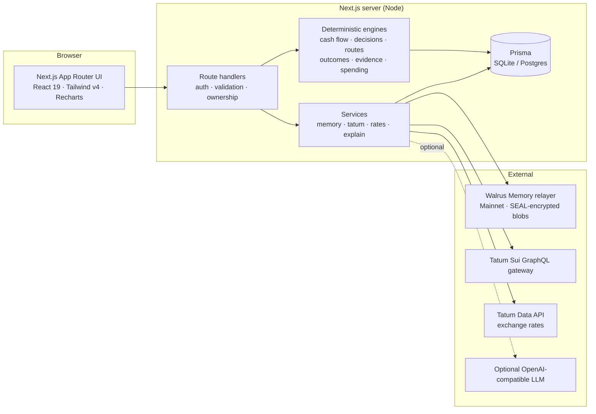

<div align="center">


# LANDED

### Money that remembers.

**A personal-finance app that tells you what is actually safe to send, save or spend — and gets sharper every week because it remembers what really happened last time.**

[**Live app →**](https://landed-production-3dc8.up.railway.app) &nbsp;·&nbsp; [Demo script](docs/demo-script.md) &nbsp;·&nbsp; [Architecture](docs/architecture.md) &nbsp;·&nbsp; [Technical blog](docs/blog.md) &nbsp;·&nbsp; [Submission checklist](docs/submission.md)

Built for the **Tatum × Walrus — Total Recall** hackathon · Consumer Finance track

`Next.js 16` · `React 19` · `TypeScript` · `Prisma` · `Walrus Memory (MemWal)` · `Tatum Sui GraphQL + Data API` · `Vitest (82 tests)`

</div>

---

## Contents

- [The problem](#the-problem)
- [What LANDED does](#what-landed-does)
- [Try it](#try-it)
- [Features](#features)
- [How memory changes the answer](#how-memory-changes-the-answer)
- [Architecture](#architecture)
- [Walrus Memory integration](#walrus-memory-integration)
- [Tatum integration](#tatum-integration)
- [Design principles](#design-principles)
- [Security and privacy](#security-and-privacy)
- [Getting started](#getting-started)
- [Configuration](#configuration)
- [Going live on Mainnet](#going-live-on-mainnet)
- [Deployment](#deployment)
- [API reference](#api-reference)
- [Data model](#data-model)
- [Testing](#testing)
- [Project structure](#project-structure)
- [Hackathon requirements](#hackathon-requirements)
- [Current status and limitations](#current-status-and-limitations)
- [Roadmap](#roadmap)

---

## The problem

Most money apps answer *"what is my balance?"* That is the wrong question. The balance includes rent due in nine days, a phone bill, the groceries you will buy this week and the cushion you never want to touch. And most apps forget everything the moment you close them: the transfer that cost more than quoted, the salary that arrived late, the subscription that quietly went up.

LANDED answers the question people actually have — **"what is safe to move right now?"** — and it **remembers** what happened after each answer, so the next one is better.

## What LANDED does

```text
your money context  →  deterministic decision  →  you act  →  the real outcome
        ↑                                                            │
        └──── memory that changes advice  ←  you confirm a lesson  ←─┘
```

1. **Sees the real picture.** Cleared balances, upcoming bills, savings goals and expected income, simulated day by day over 45 days in integer cents.
2. **Decides, and shows its work.** Safe-to-move, a recommended amount and timing, the best payment route by what actually lands, and the no-memory baseline side by side.
3. **Records what really happened.** Fees, delivery time, money left over — typed in, or read from a Sui transaction through Tatum.
4. **Learns, with your permission.** An Advice Autopsy separates facts from guesses and drafts lessons. Nothing becomes memory until you confirm it.
5. **Remembers on Walrus.** Confirmed lessons become typed rules stored on Walrus Memory, recalled on later decisions, graded by later outcomes, and restorable on any device.

## Try it

| | |
| --- | --- |
| **Live app** | https://landed-production-3dc8.up.railway.app |
| **Create an account** | Two-minute setup: balance, bills, last paycheck. No bank login, no wallet. |
| **Explore the demo** | **Explore the live demo** on the landing page opens a clearly labelled synthetic account with a few weeks of learning already in it. |

Suggested five-minute tour of the demo: **Overview** (safe-to-move $150 and the learning curve) → **Plan a move** (ask to send $300; see "$150 now, $150 after payday" next to the no-memory "$300") → **Spend Watch** (two alerts that exist only because of memory) → **Memory** (track record, Total Recall) → **Ask LANDED**: *"Can I spend $60 on dining tonight?"* and *"What did you tell me last time I asked about sending money?"* The full walkthrough is in [docs/demo-script.md](docs/demo-script.md).

## Features

### Safe-to-move and decisions
- **45-day cash-flow simulation** in integer minor units: essential and important bills, recurring obligations, savings contributions, variable spending inferred from history, and a safety buffer.
- **Expected income is never treated as cash** until it lands, unless you opt in per decision — and even then it is reliability-weighted.
- **Decisions with a counterfactual.** Every recommendation stores its exact input snapshot, the memory-informed action, the no-memory baseline, the prediction, and the memories that changed it.
- **Route ranking by what lands** — recipient amount, total cost, speed and evidence quality — adjusted by remembered route outcomes.
- **Learning Replay**: re-run any decision on its identical snapshot with and without memory; memories learned *after* the decision can never leak back into it.

### Memory that learns, and admits when it is wrong
- **Advice Autopsy**: predicted vs observed, numeric errors, confirmed causes vs hypotheses, and draft lessons.
- **Typed lessons** (11 rule kinds) that change cash-flow math, caps, splits and route ranking — each change attributed to the memory that caused it.
- **Track record**: every outcome grades the lessons behind its decision (*held* / *contradicted*). Confidence moves with evidence and weights how strongly a rule acts next time; a lesson that keeps failing is flagged for review, never silently deleted.
- **Getting sharper every week**: a weekly chart of rules in force and advice that worked, on the Overview and Memory pages.

### Spend Watch
- Detects **recurring charges** (fixed price, regular schedule) and **category pace** against your usual month.
- **Alerts only on rules you chose**: a learned monthly limit (`SPEND_LIMIT`) or an approved subscription price (`SUBSCRIPTION_WATCH`). Without memory there are zero alerts by construction; with memory every alert names the memory behind it.
- Rules are **recalled from Walrus** on every check, with per-rule provenance (*recalled from Walrus* vs *local ledger*) and visible recall coverage.
- Ask LANDED applies them too: cash flow may say yes while your own dining limit says no.

### Total Recall
- Memory belongs to the **person, not the device**: the Walrus namespace is derived from the sign-in.
- **Restore from Walrus** rebuilds the ledger on a fresh install — lessons, their latest confidence, replaced rules, and the track record.
- **Relayer inventory** (`listMemories`) independently confirms what is really stored.

### Decision journal (opt-in)
- Each answer's question, advice and reasoning is kept on Walrus in its own namespace. Ask *"what did you tell me last time?"* weeks later. It is never used as a rule.

### Real-world inputs
- **Onboarding** with balance, bills (with repeat schedules) and the last paycheck — income is forecast from its cadence.
- **Add transactions** or **import your bank's CSV export** (signed amounts, duplicate-safe by hash).
- **Sui wallet sync** and **transaction verification** through Tatum; **sourced exchange rates** from Tatum's Data API.
- **Optional AI explanations** in plain language — and any explanation containing a number LANDED did not compute is discarded.

### Account and data controls
- Change password (signs out other devices), delete account, export everything as JSON, per-lesson exclusion, opt-in consents, and a plain-language [privacy page](https://landed-production-3dc8.up.railway.app/privacy).

## How memory changes the answer

Same person, same balance, same question: **"Can I send $300 to my sister today?"**

| | Without memory | With LANDED's memory |
| --- | --- | --- |
| Answer | **Send $300** | **Send $150 now, $150 after payday** |
| Why | Balance covers it | A confirmed lesson caps a single move at 50% of safe-to-move when rent is near; a remembered route outcome prefers the reliable route |
| Evidence | — | Each adjustment names its memory ID (and Walrus blob ID once written) |

And on spending:

| | Without memory | With memory |
| --- | --- | --- |
| Spend Watch alerts | **0** | **2** — *Streaming bundle charged $21.99 — you approved $18.00*; *Dining is $32 over your $120 limit* |
| "Can I spend $60 on dining?" | Cash allows it | *"Cash-wise, yes. By the limit you asked me to hold, it would put dining $92 over — so no."* |

## Architecture



- **Deterministic core.** All money math lives in pure, tested TypeScript engines (`src/server/engine/*`) using integer minor units. No floating-point money, no LLM arithmetic.
- **Authoritative database, portable memory.** The database row holds the authoritative typed rule and is the authorization boundary; Walrus holds the portable, self-describing copy that survives devices and installs.
- **Integrations degrade honestly.** Without credentials, Walrus features report *blocked* and Tatum returns HTTP 503 with an explicit *not configured* state — never a simulated success.

| Layer | Technology |
| --- | --- |
| Framework | Next.js 16.4 (App Router, Turbopack), React 19, TypeScript 5 |
| UI | Tailwind CSS v4, Recharts, Lucide icons; Hanken Grotesk, Shantell Sans and JetBrains Mono via `next/font` |
| Data | Prisma 6 — SQLite by default, schema portable to PostgreSQL |
| Memory | `@mysten-incubation/memwal` — Walrus Memory on Mainnet |
| Onchain | Tatum Sui GraphQL gateway, Tatum Data API v4 |
| Validation | Zod 4 |
| Tests | Vitest 5, including the SDK's own `MemWalMock` |
| Deploy | Docker (Node 22 Alpine) on Railway |

## Walrus Memory integration

### Namespaces

| Namespace | Holds | Used as a rule? |
| --- | --- | --- |
| `landed-<24 hex>` | Confirmed lessons as portable text with the typed rule embedded | **Yes** — recalled for decisions and Spend Watch |
| `landed-<24 hex>-updates` | Append-only lesson changes: confidence moves, supersession, exclusion | Replayed newest-wins on restore |
| `landed-<24 hex>-journal` | Opt-in decision journal (question, advice, reasoning) | **Never** — recall only |

`<24 hex>` is `sha256("landed:email:" + normalized sign-in email)`, derived server-side. Because it is tied to the person rather than a database row, a new device or a fresh install recalls the same memory.

### SDK calls used

| Call | Where | Purpose |
| --- | --- | --- |
| `rememberAndWait` | `writeMemoryToWalrus`, `flushLessonUpdates`, journal | Write and wait for the relayer to return a blob ID — only then is a record `confirmed` |
| `recall` | decisions, Spend Watch, journal, restore | Semantic recall from the account's namespaces |
| `restore` | Restore from Walrus | Ask the relayer to re-index blobs it is missing before recall |
| `listMemories` | relayer inventory, `walrus:verify` | Count what is actually stored, independently of LANDED's database |
| `health` | integrations status | Reachability and write readiness |

### Lifecycle of a lesson

```mermaid
sequenceDiagram
    participant U as You
    participant L as LANDED
    participant DB as Database
    participant W as Walrus Memory
    L->>U: Advice (memory-informed + no-memory baseline)
    U->>L: Record the real outcome
    L->>DB: Autopsy → draft lessons (hypotheses)
    U->>L: Confirm a lesson
    L->>DB: Typed rule, user_confirmed
    L->>W: rememberAndWait(portable text) → blob ID
    Note over L,W: Next decision recalls it; the rule changes the answer
    U->>L: Record the next outcome
    L->>DB: Verdict held / contradicted → confidence moves
    L->>W: Append update to -updates namespace
    Note over U,W: New device: Restore from Walrus rebuilds lessons, state and track record
```

### Typed rules

| Rule | Effect |
| --- | --- |
| `AMOUNT_CAP` | Cap a single move at a share of safe-to-move |
| `SPLIT_TRANSFER` | Split a risky transfer; remainder after income |
| `DELAY_REMAINDER` | Wait for income before the remainder |
| `RESERVE_COMMITMENT` | Reserve extra for a matching bill inside N days |
| `EXCLUDE_EXPECTED_INCOME` | Ignore income below a reliability threshold |
| `BUFFER_FLOOR` | Raise the protected buffer |
| `ROUTE_PENALTY` / `ROUTE_PREFERENCE` | Adjust route scores from observed outcomes |
| `PAYOUT_DEDUCTION` | Reduce the expected recipient amount for a route |
| `SPEND_LIMIT` | Monthly category limit for Spend Watch and purchase checks |
| `SUBSCRIPTION_WATCH` | Approved price for a recurring merchant |

On recall the **database rule wins** and the Walrus text is a fallback, so a malformed blob can never silently rewrite financial logic. Walrus blobs are immutable, so changes are **appended**, never overwritten. Only confirmed lessons and verified journal entries are ever written — drafts and rejected lessons never leave the database.

## Tatum integration

### Sui GraphQL (`sui-mainnet.gateway.tatum.io/graphql`)

Sui has retired JSON-RPC, so LANDED reads Sui through Tatum's GraphQL gateway.

| Query | Used for |
| --- | --- |
| `checkpoint { sequenceNumber }` | Health and reachability |
| `address { balances { coinType totalBalance coinMetadata } }` | Wallet balances with correct decimals |
| `address { transactions(relation: AFFECTED) }` | Wallet history import, incoming and outgoing (duplicate-safe) |
| `transaction(digest) { effects { status gasEffects balanceChanges } }` | Outcome evidence: status, sender, per-owner balance changes, net gas |

Tatum's free plan allows 3 requests per second; rate-limited calls back off and retry.

A digest pasted when recording an outcome fills the facts in the decision's currency, and the server **re-reads it through Tatum** before marking anything `onchain_verified` — the browser's claim is never trusted. Lessons drafted from a verified outcome carry `verified_onchain` evidence.

### Data API

`POST /v4/data/rate/symbol/batch` supplies exchange rates (cached 60 s). Rates are kept as the exact decimal string returned and applied with BigInt arithmetic; converted values (SUI/stablecoin balances, gas in USD) are shown with their source and time and **never added to safe-to-move**.

## Design principles

1. **No fabricated confirmations.** `confirmed` requires a returned blob ID or a successful onchain digest; otherwise the state is `blocked`, `failed` or `pending`, and the UI says so.
2. **Nothing becomes memory automatically.** Outcomes propose; you confirm.
3. **Integer money, deterministic math.** Parsing, rounding, caps, reserves and comparisons use integer minor units; rate conversion uses BigInt.
4. **Every adjustment is attributable.** Each change to advice names the memory that caused it.
5. **Memory can be wrong — and says so.** Track records lower trust in lessons that fail.
6. **Blockchain stays invisible.** Dollars first; chain details appear only as proof.

## Security and privacy

- **Authentication**: scrypt-hashed passwords, random session tokens stored only as SHA-256 hashes, `httpOnly` + `SameSite=Lax` + `Secure` cookies, 30-day sessions, password change revokes other sessions.
- **Authorization**: every query is scoped by the authenticated user ID; cross-user access is tested against a real database. Walrus is never the authorization boundary.
- **Request hardening**: Zod validation on every input, origin checks on writes, per-user and per-IP rate limits, security headers (`X-Frame-Options`, `X-Content-Type-Options`, `Referrer-Policy`, `Permissions-Policy`, HSTS), no `X-Powered-By`.
- **Secrets**: Tatum, Walrus and AI keys are server-only and never prefixed `NEXT_PUBLIC_`.
- **Data rights**: JSON export, per-lesson exclusion, account deletion, opt-in consents. Walrus blobs are encrypted by Walrus Memory and permanent; the app states this before deletion.
- See the in-app [privacy and terms](https://landed-production-3dc8.up.railway.app/privacy).

## Getting started

**Prerequisites:** Node.js 22+, pnpm 9.

```bash
pnpm install
cp .env.example .env
pnpm setup      # prisma generate + schema + demo seed
pnpm dev
```

Open http://localhost:3000. Create an account, or choose **Explore the live demo** (demo login: `demo@landed.app` / `landed-demo-2026`).

| Command | Purpose |
| --- | --- |
| `pnpm dev` | Development server |
| `pnpm build` · `pnpm start` | Production build · serve |
| `pnpm typecheck` · `pnpm lint` · `pnpm test` | Quality gates |
| `pnpm setup` | Generate client, apply schema, seed demo |
| `pnpm db:seed` | Recreate the demo account deliberately |
| `pnpm db:reset` | Force-reset the local database and reseed |
| `pnpm demo:snapshot` | Print the demo's headline numbers and learning curve |
| `pnpm walrus:backfill [--dry-run] [--include-synthetic]` | Write confirmed lessons, journal entries and their updates to Walrus |
| `pnpm walrus:verify [--min=10]` | Verify confirmed writes against the ledger **and** the relayer inventory |

## Configuration

| Variable | Required | Description |
| --- | --- | --- |
| `DATABASE_URL` | yes | `file:./dev.db` locally; `file:/app/data/landed.db` in the container |
| `NEXT_PUBLIC_APP_URL` | yes | Public base URL |
| `TATUM_API_KEY` | for onchain features | Tatum key (server-only); enables Sui reads and the Data API |
| `TATUM_SUI_RPC_URL` | no | Defaults to `https://sui-mainnet.gateway.tatum.io` |
| `TATUM_SUI_NETWORK` | no | `mainnet` |
| `TATUM_DATA_API_URL` | no | Defaults to `https://api.tatum.io` |
| `MEMWAL_PRIVATE_KEY` | for Walrus | Walrus Memory **delegate** key (never the owner key) |
| `MEMWAL_ACCOUNT_ID` | for Walrus | Walrus Memory account ID |
| `MEMWAL_SERVER_URL` | no | Defaults to `https://relayer.memory.walrus.xyz` |
| `MEMWAL_APP_PREFIX` | no | Namespace prefix, default `landed` |
| `AI_BASE_URL` · `AI_API_KEY` · `AI_MODEL` | no | Optional OpenAI-compatible explanations |
| `LANDED_DEMO_ENABLED` | no | `false` disables the demo login |
| `LANDED_SEED_DEMO` | no | `true` seeds the demo once on container boot |

## Going live on Mainnet

1. In the Walrus Memory dashboard, create an agent and a **delegate key**; set `MEMWAL_PRIVATE_KEY` and `MEMWAL_ACCOUNT_ID`.
2. Create a Tatum API key; set `TATUM_API_KEY`.
3. Write and verify memories:
   ```bash
   pnpm walrus:backfill --include-synthetic   # demo account only; real users' confirmed lessons are written as they confirm them
   pnpm walrus:verify
   ```
4. In the app: **Memory → Walrus verification** shows relayer counts; **Settings → Integrations** shows Tatum RPC reachability and a live SUI/USD rate.

On a deployed instance, run the backfill inside the service, e.g. `railway ssh -- ./node_modules/.bin/tsx scripts/walrus-backfill.ts --include-synthetic`.

## Deployment

The repository ships a production `Dockerfile` and `railway.json`.

**Railway** (how the live app runs):

1. Create a service from this repository (Dockerfile build).
2. Attach a volume at **`/app/data`** (SQLite lives at `/app/data/landed.db`).
3. Set `RAILWAY_RUN_UID=0` (Railway volumes are root-owned), `PORT=3000`, `NEXT_PUBLIC_APP_URL`, and `LANDED_SEED_DEMO=true` if you want the demo.
4. Add the Tatum and Walrus keys when you have them.

Boot runs `prisma db push`, seeds the demo **once** (`--if-missing`), and on later boots rolls the demo's dates forward instead of reseeding — so its story stays current while lesson IDs and Walrus blob IDs never change. The healthcheck is `GET /api/health`, which verifies the database.

**Docker anywhere:**

```bash
docker build -t landed .
docker run -p 3000:3000 -v landed-data:/app/data -e LANDED_SEED_DEMO=true landed
```

For managed PostgreSQL, change the Prisma datasource provider and run migrations in a release step. Full details: [docs/setup.md](docs/setup.md).

## API reference

All routes except auth, health and the demo login require a session; all data is scoped to the signed-in user.

| Area | Endpoints |
| --- | --- |
| Auth | `POST /api/auth/signup` · `POST /api/auth/login` · `POST /api/auth/logout` · `GET /api/auth/me` · `POST /api/auth/demo` |
| Account | `POST /api/account/password` · `DELETE /api/account` · `GET/PATCH /api/settings` · `GET/POST /api/consents` · `GET /api/export` |
| Setup | `POST /api/onboarding` |
| Money data | `GET/POST /api/accounts` · `PATCH/DELETE /api/accounts/:id` · `GET/POST /api/transactions` · `POST /api/transactions/import` · `/api/commitments[/:id]` · `/api/savings-goals[/:id]` · `/api/routes` · `/api/routes/:id/quotes` |
| Decisions | `GET/POST /api/decisions` · `GET /api/decisions/:id` · `/api/decisions/:id/follow` · `POST /api/decisions/:id/outcome` · `GET/POST /api/decisions/:id/replay` · `POST /api/ask` · `GET /api/dashboard` |
| Spend Watch | `GET /api/spending` · `POST /api/spending/remember` |
| Memory | `GET /api/memories` · `POST/PATCH /api/memories/:id/feedback` · `POST /api/memories/:id/write` · `POST /api/memories/restore` · `GET /api/memories/verify` · `GET /api/learning` · `GET/POST /api/community` |
| Tatum | `GET/POST/PATCH /api/tatum/wallet` · `POST /api/tatum/transaction` · `GET /api/tatum/rates` |
| Ops | `GET /api/health` (public) · `GET /api/integrations/health` |

Errors are JSON `{ error, code, details? }` with conventional status codes (400 validation, 401, 403, 404, 409, 429, 503 for an unconfigured integration).

## Data model

| Model | Purpose |
| --- | --- |
| `User`, `Session`, `Consent`, `AuditEvent` | Identity, sessions (hashed tokens), opt-ins, audit trail |
| `FinancialAccount`, `Transaction`, `ImportBatch` | Balances, activity, CSV import de-duplication |
| `Commitment`, `SavingsGoal` | Bills (with recurrence) and goals |
| `PaymentRoute`, `RouteQuote`, `RouteObservation`, `CommunityRouteStatistic` | Routes, quotes, observed outcomes, opt-in aggregates |
| `FinancialDecision`, `MoneyMovement`, `DecisionOutcome` | Snapshotted advice, what was done, how it turned out |
| `MemoryRecord` | Lessons and journal entries: typed rule, write status, blob ID |
| `MemoryEvidence` | Track-record verdicts per lesson and decision |
| `MemoryUpdate` | Append-only lesson state changes mirrored to Walrus |

Schema: [prisma/schema.prisma](prisma/schema.prisma).

## Testing

```bash
pnpm typecheck && pnpm lint && pnpm test && pnpm build
```

82 tests across 14 files, including:

- **Money** — parsing, zero-decimal currencies, rounding, formatting.
- **Cash flow and decisions** — buffers, income exclusion, caps, reserves, recurring bills, shortfalls.
- **Routes and outcomes** — ranking, payout deductions, expired quotes, autopsy, lesson extraction.
- **Replay** — cutoff clamping so later lessons never leak backwards.
- **Spend Watch** — recurring detection (and not mistaking groceries for a subscription), memory-only alerts, newest rule wins, purchase checks.
- **Track record** — verdicts, bounded confidence, review threshold.
- **Walrus end to end** against the SDK's `MemWalMock` — confirmed writes and inventory, drafts never written, recall coverage, update flushing, journal recall, and a fresh-install restore that rebuilds lessons, state and track record.
- **Portable text** — lesson, update and journal round trips, corrupted rules.
- **Rates, CSV import, AI explanations** — BigInt conversion, sign conventions, the invented-number guard.
- **Authorization and demo clock** — cross-user denial on a real database; demo dates roll forward without touching real accounts.

## Project structure

```text
src/
  app/                  Pages (landing, login, onboarding, privacy, app/*) and API routes
  components/           UI (dashboard, plan, Spend Watch, memory, decision detail, settings…)
  lib/                  Shared types, money primitives, client helpers
  server/
    engine/             Pure, tested engines: cashflow, decision, routes, outcomes, evidence, spending
    services/           Memory (Walrus), Tatum, rates, decisions, spending, explain, demo, metrics…
    api.ts · auth.ts    Route wrapper (validation, errors, origin checks) and sessions
prisma/                 Schema and the labelled demo seed
scripts/                Walrus backfill/verify, demo snapshot, container start
tests/                  Vitest suites
docs/                   Architecture, setup, demo script, blog, submission checklist
```

## Hackathon requirements

| Requirement | How LANDED meets it |
| --- | --- |
| Walrus Memory integrated and writing on Mainnet | `rememberAndWait` / `recall` / `restore` / `listMemories`; three namespaces; writes confirmed only with a blob ID |
| Tatum RPC for onchain data | Sui GraphQL gateway for balances, history and settlement evidence; Data API for rates |
| ≥ 10 memories on Mainnet | 21 lessons + 5 journal entries + track-record updates ready via `walrus:backfill`; `walrus:verify` checks ledger and relayer inventory |
| Blog post | [docs/blog.md](docs/blog.md) |
| Working demo and public repo | [Live app](https://landed-production-3dc8.up.railway.app) with a self-refreshing demo account |
| *Keeps scores, preferences, and reasoning* | Scores: track record · Preferences: typed rules · Reasoning: decision journal |
| *Sharper every week* | Weekly learning curve; confidence that moves with evidence |
| *Web2 welcome / blockchain invisible* | Dollars-first UI, no wallet required, chain data only as proof |
| Consumer Finance track | Safe-to-move, Spend Watch with learned limits, savings goals, payment routes |

Judging-criteria evidence is mapped in [docs/submission.md](docs/submission.md).

## Current status and limitations

- **Live on Mainnet.** The deployment writes and recalls through Walrus Memory on Mainnet (25 confirmed writes, verified against the relayer inventory) and reads Sui Mainnet through Tatum. A checkout without keys shows *local rehearsal* / *not configured* instead of simulating success.
- **Tatum free plan.** It allows 3 requests per second; LANDED retries rate-limited calls, but heavy concurrent use needs a paid plan.
- **No bank connections by design.** Balances are self-reported, CSV-imported or verified onchain; route quotes are user-entered.
- **LANDED never moves money.** It advises and records outcomes.
- **Single instance.** SQLite on a volume and in-memory rate limits suit one server; use PostgreSQL and a shared rate limiter to scale out.
- **No email delivery yet**, so there is no password-reset email.
- **FX** is shown for reference only, with a sourced Tatum rate.

## Roadmap

- Password reset and email verification.
- PostgreSQL and horizontal scaling.
- Shared budgets: household memory across two accounts.
- Agent payments: settle a recommended transfer with x402 / MPP on Sui.
- Bank-feed connectors behind the same honesty states.

---

<div align="center">

**LANDED** · Built for the Tatum × Walrus Total Recall hackathon · Walrus Memory keeps the learning, Tatum keeps it verifiable.

</div>
